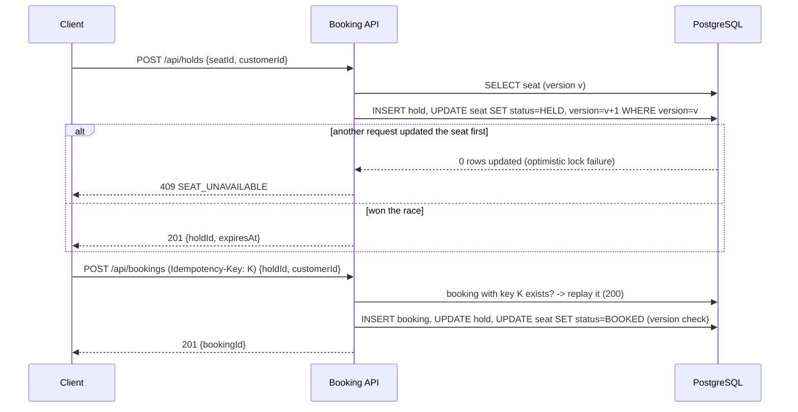

# Concurrent Seat Booking Engine

[](https://github.com/AryaShah800/concurrent-seat-booking-engine/actions/workflows/ci.yml)

A Spring Boot 3 / PostgreSQL backend for ticket-style seat booking that guarantees **one seat is booked at most once**, even when many clients race for it.

- **Seat holds with expiry.** A customer holds a seat for a configurable TTL (default 5 minutes) and then confirms it. Lapsed holds stop blocking the seat immediately, and a scheduled sweeper releases them in the database.
- **Optimistic locking.** `@Version` on the seat row means that when N requests race for one seat, exactly one `UPDATE ... WHERE version = ?` succeeds. The rest get `409 SEAT_UNAVAILABLE`.
- **Idempotent bookings.** `POST /api/bookings` requires an `Idempotency-Key` header.
  - Retrying with the same key and body returns the original booking (`200` plus `Idempotent-Replayed: true`).
  - Reusing the key with a different body returns `422`.
  - Concurrent duplicates collapse into one booking.
- **Database as the last line of defence.** UNIQUE constraints on `bookings.seat_id`, `bookings.hold_id` and `bookings.idempotency_key`.

**Not included:** Redis, Kafka and authentication. Holds live in PostgreSQL. A Redis or Kafka integration would be a future extension and is not claimed here.

## Stack

Java 21 · Spring Boot 3.5 (Web, Data JPA, Validation, Actuator) · PostgreSQL 16 · Flyway · springdoc-openapi (Swagger UI) · JUnit 5 + Testcontainers · JaCoCo · k6 · Docker / Docker Compose · GitHub Actions

## How a booking works



| Seat state | Meaning |
| --- | --- |
| `AVAILABLE` | Free to hold |
| `HELD` | Reserved until `hold_expires_at`; after that, anyone can hold it again |
| `BOOKED` | Final |

## API

Interactive docs: `http://localhost:8080/swagger-ui.html` (OpenAPI JSON at `/v3/api-docs`).

| Method | Path | Result |
| --- | --- | --- |
| `POST` | `/api/shows` `{name, startsAt, rows, seatsPerRow}` | `201`, creates a show with seats `A1`, `A2`, ... |
| `GET` | `/api/shows/{id}/seats` | Seats with their current status |
| `POST` | `/api/holds` `{seatId, customerId}` | `201` hold, or `409 SEAT_UNAVAILABLE` |
| `DELETE` | `/api/holds/{holdId}?customerId=` | `204`, releases the hold early |
| `POST` | `/api/bookings` + `Idempotency-Key` `{holdId, customerId}` | `201` booking, `200` replay, `409 HOLD_NOT_ACTIVE`, `403 HOLD_NOT_OWNED`, `422 IDEMPOTENCY_KEY_REUSED` |
| `GET` | `/api/bookings/{id}` | The booking |

Errors use RFC 9457 problem details with a stable `code` field.

## Run it

```bash
docker compose up -d --build          # PostgreSQL 16 + API on http://localhost:8080
# or, with a local PostgreSQL: mvn spring-boot:run  (DB_URL / DB_USERNAME / DB_PASSWORD)
```

Configuration (environment variables): `DB_URL`, `DB_USERNAME`, `DB_PASSWORD`, `DB_POOL_SIZE` (default 20), `BOOKING_HOLD_TTL` (ISO-8601, default `PT5M`), `BOOKING_SWEEP_INTERVAL` (default `PT5S`), `APP_PORT` (compose host port, default 8080).

The compose file's database password is a local-development default. Set `DB_PASSWORD` for anything else.

## Tests

```bash
mvn verify      # needs Docker: Testcontainers starts postgres:16
```

All integration tests run against a **real PostgreSQL 16 in Testcontainers**, not H2, so the locking and constraint behaviour is PostgreSQL's own. A mutable test clock makes hold expiry deterministic, with no sleeps.

| Test class | What it proves |
| --- | --- |
| `ConcurrentBookingTest` | **50 threads race for one seat behind a start gate: exactly 1 hold wins, 49 get `SEAT_UNAVAILABLE`** (repeated 5 times). 20 concurrent confirms with the same key give 1 booking and 19 replays of it. 20 confirms with different keys give 1 booking. 50 HTTP clients doing hold and confirm on one seat give exactly one `201`, one booking and 49 `409`s. |
| `BookingLifecycleTest` | Hold then confirm; booked and held seats block others; expired holds free the seat and can't be confirmed; sweeper; release; ownership checks; idempotent retry; key reuse rejected; 404s |
| `BookingApiTest` | REST contract end to end: status codes, `Idempotent-Replayed` header, validation errors, problem details, OpenAPI and health endpoints |
| `SeatTest`, `BookingPropertiesTest` | Plain unit tests of the state rules and config |

| `BookingServiceTest` | Mockito unit tests that force rare race interleavings deterministically. Example: a duplicate same-key confirm that reads the hold just after the winner committed must replay the booking, not return 409. CI's concurrency test caught this case once before it was fixed. |

Latest local run (JDK 24 compiling for Java 21, Windows 11, Docker Desktop): **38 test executions (34 test methods), 0 failures.** JaCoCo coverage from that run: **91.9% of lines, 77.5% of branches.** CI runs the same `mvn verify` on JDK 21 and prints the coverage in the job summary. The CI run for commit `c1207cd` had 38 tests, 0 failures, **92.3% line and 78.9% branch coverage**.

## Load test (k6)

`load/booking-race.js` is a flash-sale scenario. Every virtual user loops, with no think time:

1. Hold a random seat.
2. On a win, confirm it with a fresh `Idempotency-Key`.
3. Replay that confirm with the same key, expecting the same `bookingId`.

The run fails if any response has an unexpected status or a replay returns a different booking. Afterwards, `load/verify-no-double-booking.sql` checks the database directly.

```bash
docker compose up -d --build
docker compose --profile load run --rm k6                      # 200 VUs, 60 s, 4 shows x 2,600 seats
VUS=100 DURATION=60s SHOWS=8 docker compose --profile load run --rm k6
docker compose exec -T postgres psql -U seatbooking -d seatbooking < load/verify-no-double-booking.sql
```

### Measured results (2026-11-14)

How these were measured:
- Each run started from a fresh database (`docker compose down -v` then `up`).
- A 20 s warm-up at 50 VUs ran first so the JVM was warm.
- The measured run had 8 shows × 2,600 = 20,800 seats, so the venue did not sell out.
- The code measured was commit `bd57d6b`. The only later change to `src/main` (the late-duplicate replay fix) affects a path that returns 409. That path never fired in these runs (0 unexpected statuses), so the numbers stand.
- k6 0.54.0 ran in a container on the compose network. Raw k6 summaries are in [`load/measured/`](load/measured/).

| | 100 VUs, 60 s | 200 VUs, 60 s |
| --- | --- | --- |
| HTTP requests (throughput) | 69,521 (1,009 req/s) | 42,161 (561 req/s) |
| Holds won / lost to a race (409) | 17,018 / 18,451 | 12,017 / 6,094 |
| Bookings created | 17,018 | 12,017 |
| Idempotent replays returning the same booking | 17,018 / 17,018 | 12,017 / 12,017 |
| Unexpected status codes | 0 | 0 |
| **Seats booked twice (SQL check)** | **0** | **0** |
| Hold latency p50 / p95 / p99 | 47.6 / 118.4 / 171.8 ms | 64.2 / 273.4 / 487.7 ms |
| Confirm latency p50 / p95 / p99 | 92.7 / 381.0 / 474.3 ms | 223.3 / 1,226.9 / 1,450.9 ms |
| All requests p95 | 303.0 ms | 1,074.0 ms |

**Read these numbers with care.**
- They come from **one Windows 11 laptop** (12 logical CPUs; Docker Desktop VM with 7.6 GB RAM). The app, PostgreSQL and k6 all ran on it, while other unrelated builds were running too.
- They show the locking holds under contention. They are not a capacity figure for real hardware.
- At 200 VUs, throughput drops and confirm latency rises because the 30-connection pool and the shared CPU saturate. Every confirm does an idempotency lookup plus a 3-row write transaction.
- An earlier run at 200 VUs on a cold JVM, without warm-up, measured confirm p95 at 2.3 s. That also had 0 double bookings.

## Project layout

```
src/main/java/com/aryashah/seatbooking
  domain/       Seat (@Version), Hold, Booking, Show
  repository/   Spring Data JPA repositories (+ bulk expiry updates)
  service/      BookingService (holds, confirms, idempotency), HoldExpiryJob, ShowService
  web/          REST controllers, DTOs, problem-detail error handler
src/main/resources/db/migration   Flyway schema (UNIQUE constraints, partial indexes)
load/           k6 script, SQL double-booking check, measured k6 summaries
```

## License

MIT
